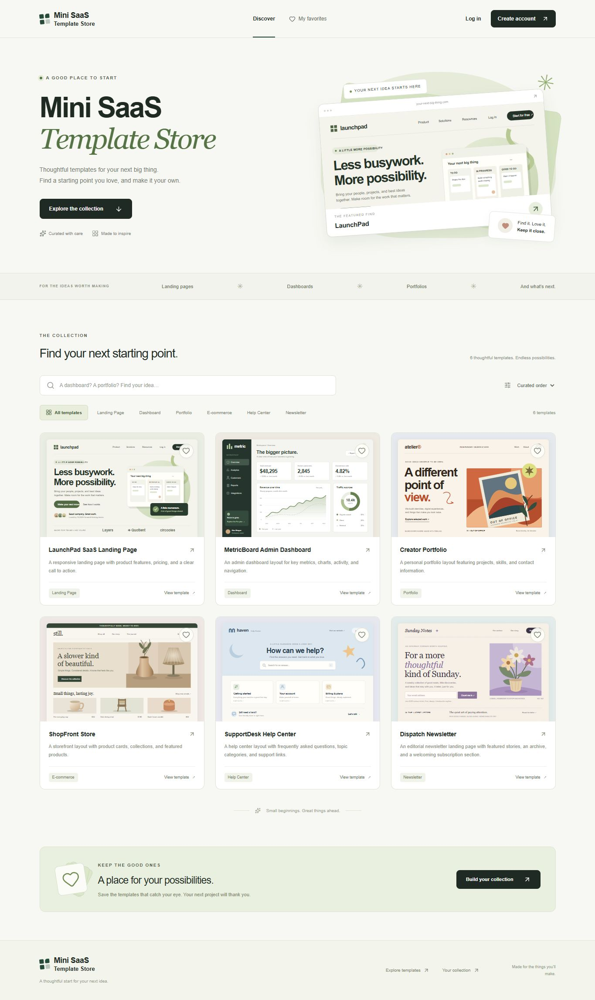
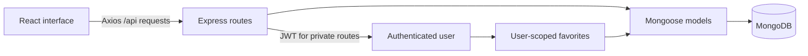

# Mini SaaS Template Store

A MERN application for discovering website templates and keeping a personal collection of favorites. Built for the **Gnxtace Technologies Software Engineer Intern Assessment**.

The six catalog entries are sample design concepts illustrated with original SVG previews. The repository contains the complete catalog application's source code; the previews are illustrations rather than downloadable website packages.

**Author:** Balaji Kumar

**Contact:** [GitHub — balajikumar-dev](https://github.com/balajikumar-dev)

**Source:** [fullstack-intern-task](https://github.com/balajikumar-dev/fullstack-intern-task)



## Features

- Register and sign in with bcrypt password hashing and JWT authentication.
- Browse six seeded templates, each with a thumbnail, name, description and category.
- Search templates and filter by category.
- Open a template's details and save or remove it from your favorites.
- Keep favorites in MongoDB so they remain available after refreshing or signing in again.
- Protect the Favorites page and its API using the signed-in user's identity.
- Log out, show loading/error/empty states, and use the interface on desktop or mobile.

## Stack

| Layer            | Technology                                                     |
| ---------------- | -------------------------------------------------------------- |
| Frontend         | React, Vite, React Router, Axios, Tailwind CSS, Lucide icons   |
| Backend          | Node.js, Express, Mongoose, bcryptjs, jsonwebtoken             |
| Database         | MongoDB, with User, Template and Favorite collections          |
| Checks           | Frontend lint/build, backend integration tests, GitHub Actions |
| Optional hosting | Vercel frontend, Render API, MongoDB Atlas                     |

## Run locally

Use **Node.js 24.x**, npm and a running MongoDB server. MongoDB should be available at `127.0.0.1:27017` for the default local configuration and integration tests. Open `fullstack-intern-task` in VS Code.

### 1. Install dependencies

From the project root in PowerShell:

```powershell
cd server
npm.cmd ci
cd ../client
npm.cmd ci
cd ..
```

On macOS/Linux, the same commands work with `npm` instead of `npm.cmd`. The `.cmd` form avoids changing PowerShell's execution policy on Windows. Both lockfiles are committed for repeatable installs.

### 2. Configure the backend

Create `server/.env` from `server/.env.example` **only if it does not already exist**:

```powershell
if (-not (Test-Path server/.env)) { Copy-Item server/.env.example server/.env }
```

On macOS/Linux, use `test -f server/.env || cp server/.env.example server/.env`.

Set these values in the local file:

```dotenv
PORT=5000
MONGO_URI=mongodb://127.0.0.1:27017/mini_saas_template_store
JWT_SECRET=replace-with-a-random-secret-at-least-32-characters-long
CLIENT_ORIGIN=http://localhost:5173,http://127.0.0.1:5173
TRUST_PROXY=0
```

Generate your own random secret with the command below and use its output as `JWT_SECRET`. Replace the example value before starting the API.

```powershell
node -e "console.log(require('crypto').randomBytes(32).toString('hex'))"
```

Environment files are ignored by Git. Keep the real database URI and JWT signing secret out of source code. If using Atlas, replace `MONGO_URI` privately and configure its database user and network access. Existing process environment values take precedence over the file.

### 3. Seed templates and start the API

Start MongoDB, then run these commands in a terminal from the project root:

```powershell
cd server
npm.cmd run db:seed
npm.cmd run db:check
npm.cmd run dev
```

The seed uses stable IDs so repeat runs do not create duplicate samples. It preserves existing edits and upgrades only the original `placehold.co` thumbnails to the bundled previews. Template SVG previews are served by the backend at `/previews`; no external image account is needed.

The API runs at `http://localhost:5000`. Its [health endpoint](http://localhost:5000/health) returns HTTP 200 while the database is connected:

```json
{ "status": "ok", "database": "connected" }
```

For a regular backend process without the development watcher, use `npm.cmd start`.

### 4. Start the frontend

Open a second terminal from the project root:

```powershell
cd client
npm.cmd run dev
```

Open the URL Vite prints, normally [http://localhost:5173](http://localhost:5173). The default `/api` base URL goes through the local Vite proxy to port 5000. Register your own account to try favorites.

On the prepared Windows computer, the earlier Step 2 process occupies port 5000. The ignored local files select `PORT=5001` and `VITE_API_URL=http://localhost:5001/api`; the current API health URL is `http://localhost:5001/health`. A fresh clone uses port 5000 by default. If you choose another port, update both local environment files together.

When using a separately hosted API, set `VITE_API_URL` in an ignored `client/.env` file to its complete API base URL, such as `https://your-backend.onrender.com/api`, and restart Vite or rebuild the frontend. This is a public URL; database credentials and `JWT_SECRET` belong only on the backend.

## Application routes

| Route            | Purpose                                                 |
| ---------------- | ------------------------------------------------------- |
| `/register`      | Create an account.                                      |
| `/login`         | Sign in to an existing account.                         |
| `/templates`     | Browse, search and filter templates.                    |
| `/templates/:id` | View a template's details and full-size design preview. |
| `/favorites`     | View and manage your saved templates; sign-in required. |

The gallery loads the catalog through Axios, then applies its search and category controls in the browser. The API also exposes matching search/category parameters for direct API consumers. The root `/` redirects to `/templates`.

## API reference

Use `Content-Type: application/json` for JSON request bodies. Authenticated requests send `Authorization: Bearer <token>`.

| Method   | Path                         | Authentication | Behavior                                                                         |
| -------- | ---------------------------- | -------------- | -------------------------------------------------------------------------------- |
| `GET`    | `/`                          | Public         | API running status.                                                              |
| `GET`    | `/health`                    | Public         | Database health; returns 503 if disconnected.                                    |
| `POST`   | `/api/auth/register`         | Public         | Accepts `{name, email, password}`; returns `{token, user}`.                      |
| `POST`   | `/api/auth/login`            | Public         | Accepts `{email, password}`; returns `{token, user}`.                            |
| `GET`    | `/api/auth/me`               | Bearer token   | Returns `{user}` for the current session.                                        |
| `GET`    | `/api/templates`             | Public         | Returns `{templates: [...]}`. Supports `search` and `category` query parameters. |
| `GET`    | `/api/templates/:id`         | Public         | Returns `{template}`.                                                            |
| `GET`    | `/api/favorites`             | Bearer token   | Returns `{templates: [...]}` for the current user.                               |
| `POST`   | `/api/favorites/:templateId` | Bearer token   | Saves a template; first save returns 201, repeat save returns 200.               |
| `DELETE` | `/api/favorites/:templateId` | Bearer token   | Removes a saved template.                                                        |

Example search: `/api/templates?search=dashboard&category=Dashboard`.

Errors use `{ "message": "..." }` with an appropriate status: 400 for invalid input, 401 for missing/invalid credentials, 404 for a missing template, 409 for a duplicate email, and 429 for too many authentication attempts. Password hashes never appear in user responses.

## Structure and data flow

```text
fullstack-intern-task/
├── client/
│   ├── src/
│   │   ├── components/      Navbar, TemplateCard and ProtectedRoute
│   │   ├── pages/           Register, Login, Templates, TemplateDetails and Favorites
│   │   ├── services/        api, authService, templateService and favoriteService
│   │   └── context/         AuthContext.jsx
│   ├── .env.example         Public API URL example
│   ├── vite.config.js       React/Tailwind plugins and local API proxy
│   └── vercel.json          Frontend deployment and SPA route fallback
├── server/
│   ├── config/              Environment and database setup
│   ├── models/              User, Template and Favorite schemas
│   ├── routes/              API endpoints
│   ├── controllers/         Request handlers
│   ├── services/            Application logic
│   ├── middleware/          Authentication and request/error handling
│   ├── data/                Sample template records
│   ├── public/              Template preview assets
│   ├── seed/seedTemplates.js Sample data seed entry point
│   ├── scripts/             Seed implementation and database checks
│   ├── tests/               API integration checks
│   └── server.js            API startup
├── docs/DEPLOYMENT.md        Hosted setup and verification
├── .github/workflows/ci.yml Frontend/backend checks
└── render.yaml              Optional backend deployment
```



Users have a unique, normalized email and a private bcrypt password hash. Templates expose the assessment fields `id`, `name`, `description`, `thumbnail_url` and `category`. A Favorite references one user and one template; a compound unique index prevents saving the same pair twice.

The client keeps the JWT in `localStorage` as required by the assessment, adds it to API requests and removes it on logout. The server verifies the signature and a seven-day expiry, then derives favorite ownership from the verified user. Logout clears the browser session; this version does not maintain a server-side token revocation list. For a production service, short sessions with secure HttpOnly cookies and a token revocation/refresh strategy would reduce the risks of browser-script access to stored tokens.

The backend validates input, limits JSON request size, applies security headers, restricts browser origins and limits failed login/registration attempts to 30 per 15 minutes per IP. Registration passwords must contain at least eight characters and fit within bcrypt's 72-byte limit. The frontend route guard improves navigation, while the API authentication middleware independently enforces access.

## Checks

Run the frontend checks from `client/`:

```powershell
npm.cmd run lint
npm.cmd run build
```

Run API integration tests from `server/` with local MongoDB running:

```powershell
npm.cmd test
```

Tests use a uniquely named `mini_saas_test_...` database on `127.0.0.1:27017`. The test runner ignores the application's `MONGO_URI` and only cleans up its own guarded test database. The application database and its saved favorites are not test fixtures.

GitHub Actions runs the same frontend checks plus the API tests against a MongoDB service container on pushes and pull requests. The workflow is included in the repository; its status is visible in the repository's Actions tab after a push. The [official setup-node examples](https://github.com/actions/setup-node) document the Node setup and dependency-cache configuration.

For a manual walkthrough: register, search/filter, open template details, save a favorite, refresh, log out, sign back in, and remove the favorite. Also try an incorrect password and visit `/favorites` after logging out to check the error and protected-route behavior.

## Assessment coverage

| Area                  | Implementation                                                                                    |
| --------------------- | ------------------------------------------------------------------------------------------------- |
| Code structure — 25%  | Separate client/server folders, reusable UI parts, API routes, middleware and database models.    |
| Functionality — 25%   | Registration/login, six seeded templates, template details and persistent per-user favorites.     |
| UI & UX — 20%         | Responsive template gallery, preview artwork, clear form feedback and loading/empty/error states. |
| API integration — 20% | Axios requests, bearer authentication, database-backed content and favorite updates.              |
| Bonus — 10%           | Search, category filters, logout, remove-favorite action, CI and deployment configuration.        |

Hosting configuration is provided in [the deployment guide](docs/DEPLOYMENT.md). A public live deployment is separate from these configuration files and should be linked here after it has been deployed and verified.

For a guided code review and demonstration, see [the project walkthrough](docs/PROJECT-WALKTHROUGH.md).

Local test results and remaining submission steps are recorded in [verification notes](docs/VERIFICATION.md).
